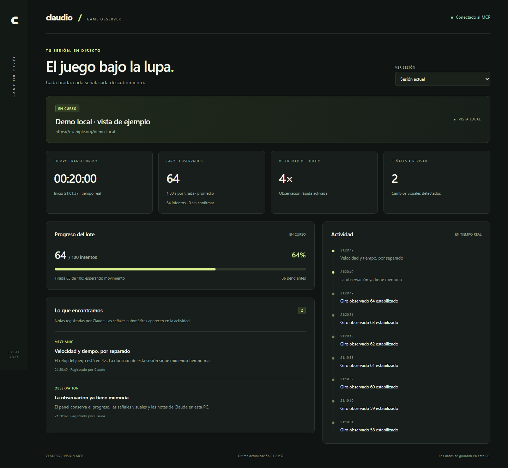

# Claudio

MCP local para Claude que opera juegos **demo** por capturas y coordenadas. Incluye velocidad regulable, observación rápida y dashboard en vivo con progreso, tiempo real, señales visuales y descubrimientos de Claude.

El panel funciona en tu PC, sin cuentas ni servicios externos. Los controles siguen siendo visuales; la aceleración instrumenta el reloj JavaScript del navegador, sin interpretar el protocolo del juego.



## Instalar

Necesitas **Node.js 20+** (recomendado: 22 LTS).

```powershell
git clone https://github.com/Shisetsu-Code/Claudio.git
cd Claudio
npm ci
```

Se descarga Chromium automáticamente. Si omitiste ese paso: `npx playwright install chromium`.

### Claude Desktop

Abre la configuración de desarrollador de Claude y edita `claude_desktop_config.json`. Añade este servidor dentro de `mcpServers`, conservando los demás. Sustituye las rutas:

```json
{
  "mcpServers": {
    "slots": {
      "command": "C:/Program Files/nodejs/node.exe",
      "args": ["C:/ruta/Claudio/server.mjs"]
    }
  }
}
```

En macOS/Linux usa las rutas absolutas correspondientes. La versión de Microsoft Store puede guardar este archivo dentro de `LocalCache/Roaming/Claude` del paquete de la aplicación; localízalo con el editor de configuración de Claude.

Cierra Claude completamente, incluido el icono junto al reloj, y vuelve a abrirlo. Deben aparecer **17 herramientas** de `slots`.

### Claude Code

```powershell
claude mcp add --transport stdio --scope user slots -- node "C:/ruta/Claudio/server.mjs"
```

Abre una sesión nueva y usa `/mcp` para comprobar la conexión.

## Empezar

Pídele a Claude:

> Usa slots. Abre esta URL de juego demo, muéstrame el enlace de get_dashboard y toma una captura con grid 100. Localiza los botones y guarda los puntos. Configura set_speed con rate 2 y fast_mode true. Haz un lote de 10 intentos sin cambiar la apuesta. Registra con record_finding cada mecánica, bonus o problema que observes, describiendo la evidencia.

El dashboard suele abrirse en **http://127.0.0.1:4317**. Si ese puerto está ocupado, se elige uno libre. `get_dashboard` devuelve la dirección efectiva. El MCP debe seguir ejecutándose para ver el panel.

## Velocidad

Llama a `set_speed` con `{"rate":4,"fast_mode":true}`. Admite **1× a 8×**; empieza por 2× y prueba 4×. Para volver a normal: `{"rate":1,"fast_mode":false}`.

- `rate` escala `Date`, `performance.now`, timestamps de `requestAnimationFrame`, temporizadores y animaciones CSS/Web Animations compatibles. Se aplica a frames y navegaciones de la sesión.
- `fast_mode` reduce los intervalos de observación manteniendo comprobaciones de movimiento y estabilidad. Chromium también evita reducir su actividad por estar en segundo plano.
- Dashboard, presupuestos de llamada, red y servidor del juego mantienen el tiempo real.
- La mejora depende del motor. Los pasos fijos por frame, workers, audio y otros relojes independientes pueden acelerar parcialmente o no acelerar. Si aparecen fallos, vuelve a 1×; vuelve a cargar el juego si conservó un estado inconsistente.
- La observación rápida puede perder animaciones muy breves. Ajusta los umbrales de movimiento, estabilidad, luminosidad y escena según la demo.

## Seguimiento

El dashboard muestra juego, estado, fase, velocidad, duración real, objetivo y avance del lote, señales visuales, notas e historial.

**Giros observados** son intentos donde el detector vio movimiento y después evaluó estabilidad. Es una medida visual, no una confirmación del servidor ni una lectura de apuestas o premios. **Intentos** son acciones enviadas: una acción sin reacción cuenta como intento, pero no como giro observado. **Sin confirmar / en curso** distingue acciones interrumpidas antes de observarlas completamente. El próximo lote espera su estabilidad y registra lo pendiente antes de enviar otra acción.

Los contadores del lote representan intentos evaluados. Cambios de escena, luminosidad o falta de reacción son señales para revisar: no demuestran un bonus. Claude debe usar `record_finding` para registrar lo que descubre; el MCP no puede leer sus pensamientos ni las respuestas del chat.

Cada lanzamiento inicia una sesión con contadores nuevos y velocidad normal. La duración de una sesión cerrada queda congelada. Se conservan las últimas 20 sesiones anteriores, hasta 300 eventos y 100 notas por sesión.

## Herramientas

| Herramienta | Uso |
|---|---|
| `launch_game` | Abre Chromium, carga URL y devuelve captura/enlace del panel. |
| `screenshot` | JPEG con cuadrícula opcional `grid:100`. |
| `act` | Hasta 30 acciones: `click`, `key`, `wait`, `wait_stable`; captura final. |
| `wait_stable` | Espera por diferencias de imagen hasta estabilidad o timeout. |
| `spin_loop` | Lote de clics/teclas; publica avances y detecta anomalías. |
| `set_speed` | `rate` 1–8×, `fast_mode` booleano; informa frames actualizados. |
| `get_status` | Estado, progreso, duración e historial, incluso durante un lote. |
| `get_dashboard` | Dirección efectiva del dashboard local. |
| `record_finding` | `title`, `detail`, `category`: observation/mechanic/bonus/issue/strategy. |
| `stop_loop` | Solicita detener el lote sin deshacer acciones enviadas. |
| `set_point` / `list_points` | Define/consulta coordenadas con nombre. |
| `save_profile` / `load_profile` | Guarda/carga puntos por juego; verifica el viewport. |
| `list_frames` | URLs de frames para diagnóstico. |
| `get_network_log` | Registro opcional; requiere `capture_network:true` al lanzar. |
| `close_game` | Cierra el navegador y finaliza la sesión; conserva el panel. |

`spin_loop` usa por defecto un presupuesto de **50 segundos reales**, incluidas sus esperas internas. Si termina con una acción en curso, no se da por confirmada ni se pulsa de nuevo sin esperar. `time_budget` permite continuar con otro lote. Los campos heredados `tiradas_hechas` y `pendientes` representan iteraciones evaluadas, no resultados económicos. Solo se acepta clic o tecla como acción repetida para evitar esperas arbitrarias que excedan el presupuesto.

Durante una herramienta de navegador se rechazan otras acciones visuales concurrentes. Sí puedes consultar el estado, registrar notas, cambiar velocidad o solicitar detener el lote.

## Datos locales

| Variable | Valor predeterminado |
|---|---|
| `CLAUDIO_DASHBOARD_PORT` | `4317`; `0` elige un puerto libre. |
| `CLAUDIO_DATA_DIR` | `data` junto a `server.mjs`. |

El historial se guarda en `data/sessions.json`; los puntos en `profiles.json`. Las URLs y notas pueden contener datos de sesión. Historial, perfiles, capturas y node_modules están excluidos de Git. Usa un `CLAUDIO_DATA_DIR` distinto por cada proceso independiente del MCP.

El dashboard escucha solo en `127.0.0.1`, tiene endpoints de lectura, rechaza hosts/orígenes ajenos y no incluye cuerpos de red. El registro de red está desactivado por defecto para reducir trabajo y memoria; si lo activas, revísalo antes de compartirlo.

stdout contiene exclusivamente el protocolo MCP; la dirección del panel se anuncia por stderr y `get_dashboard`. Al salir o desconectarse Claude se cierran los recursos y se conserva el estado final.

## Pruebas

```powershell
npm run check
npm test
```

Usan Chromium real y una demo local determinista: relojes y frames, restauración de velocidad, historial, eventos en vivo, progreso durante ejecución, cancelación, presupuesto real, errores, cierre y renderizado del dashboard. No realizan apuestas ni llaman a juegos externos.

La compatibilidad y los umbrales todavía deben calibrarse con cada juego demo real; las pruebas locales no confirman compatibilidad con todos los motores.
